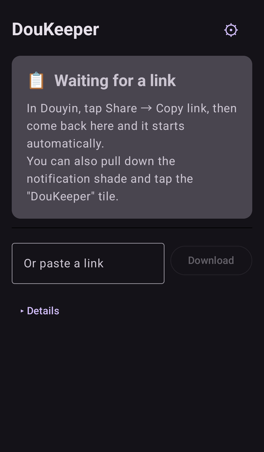
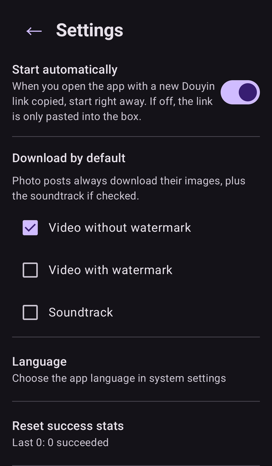

# DouKeeper

**Save Douyin (抖音) videos to your Android phone — without watermarks, in two taps.**

Copy a share link in Douyin, switch to DouKeeper, and the download starts by itself.

[繁體中文說明](#繁體中文) · [Download APK](https://github.com/MrDaDaDo/DouKeeper/releases/latest)

<p>
  
  
</p>

## How to use

1. In Douyin, tap **Share → Copy link**.
2. Open DouKeeper — or pull down the notification shade and tap the **DouKeeper** tile.
3. It starts automatically. If Douyin shows a "verify you're human" check, finish it in the page that appears.

Downloads keep going in the background; tap the notification when it's done.

## Features

- **Video without watermark**, video with watermark, soundtrack, and photo-post images
- **Background downloads** with progress in the notification shade
- **Quick Settings tile** to start from anywhere
- Pick what to download by default, and whether to start automatically
- English, 繁體中文, 简体中文
- Files go to your gallery: `Movies/DouKeeper`, `Pictures/DouKeeper`, `Music/DouKeeper`
- **No storage permission, no account, no ads, no tracking**

## How is this different?

Douyin no longer serves video data to plain HTTP requests, and many downloaders break when it changes its
request signing. DouKeeper doesn't try to beat that:

- It **loads the real Douyin web page** in a WebView and reads the video details the page itself requests.
  The page handles its own signing and cookies, so there is nothing to reverse-engineer.
- When Douyin asks for a human check, **you complete it yourself**. DouKeeper never tries to bypass it.
  One check usually lasts for many downloads.
- **No server in between.** Everything happens on your phone; nothing is sent anywhere except Douyin.

The trade-off: it needs a recent Android System WebView, and it can still break if Douyin changes its
web page. See [`docs/SPEC.md`](docs/SPEC.md) §5.B for how parsing works.

## Requirements

- Android 10 or later
- Android System WebView up to date (via Google Play)

## Install

Download `DouKeeper-v*.apk` from [Releases](https://github.com/MrDaDaDo/DouKeeper/releases/latest) and open it.
Android will ask you to allow installing from your browser or file manager.

DouKeeper is not on Google Play — Play doesn't allow apps that download content from other platforms.

## Build

Requires **JDK 21** (Gradle 8.14 doesn't run on JDK 25 yet).

```bash
./gradlew :app:testDebugUnitTest :app:assembleDebug
```

Release builds need a signing key; see [`docs/RELEASE.md`](docs/RELEASE.md).

## Disclaimer

For personal use only. Respect the creators and Douyin's terms of service, and don't re-upload other
people's work without permission. This project is not affiliated with Douyin or ByteDance.

## License

[MIT](LICENSE)

---

## 繁體中文

**把抖音作品存到 Android 手機，無浮水印，點兩下就好。**

### 使用方式

1. 在抖音按 **分享 → 複製連結**。
2. 打開 DouKeeper，或下拉通知欄點 **DouKeeper** 磚塊。
3. 會自動開始。抖音要求人機驗證時，在 App 裡出現的網頁手動完成。

下載在背景進行，可以切到別的 App，完成後點通知開啟。

### 功能

- **無浮水印影片**、有浮水印影片、配樂、圖文作品的圖片
- 背景下載，通知欄顯示進度
- 快速設定磚塊，在哪裡都能啟動
- 可設定預設下載內容、是否自動開始
- 介面：English、繁體中文、简体中文
- 檔案存在相簿的 `Movies/DouKeeper`、`Pictures/DouKeeper`、`Music/DouKeeper`
- **不需要儲存權限、不用登入、沒有廣告、不追蹤**

### 跟其他下載器有什麼不同

- **載入真正的抖音網頁**，讀取網頁自己發出的請求結果。簽章和 cookie 都由網頁處理，不需要破解。
- 出現人機驗證時**由你自己完成**，不嘗試繞過。通過一次通常可以撐很多次下載。
- **沒有中間伺服器**，所有事情都在手機上完成。

代價是需要較新的 Android System WebView，抖音改網頁時仍可能失效。

### 安裝

到 [Releases](https://github.com/MrDaDaDo/DouKeeper/releases/latest) 下載 `DouKeeper-v*.apk` 開啟安裝。
不在 Google Play 上架：Play 不允許下載其他平台內容的 App。

### 文件

| 檔案 | 內容 |
|---|---|
| [`docs/SPEC.md`](docs/SPEC.md) | 主文件：決策紀錄、架構、解析與下載規格、實測紀錄、風險 |
| [`docs/RELEASE.md`](docs/RELEASE.md) | 簽章金鑰的保管與每次發布的步驟 |

### 聲明

僅供個人使用。請尊重創作者與抖音的服務條款，未經同意不要轉載他人作品。本專案與抖音、字節跳動無關。
